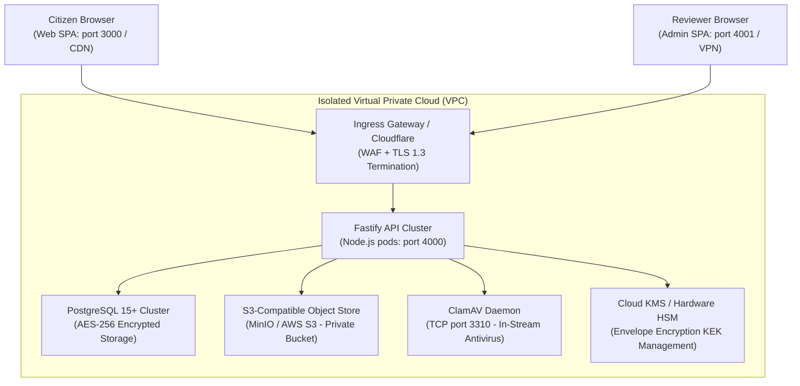

# Production Deployment & Infrastructure Runbook

> **Target Environment:** Containerized Cloud Infrastructure (Kubernetes / Docker Compose)  
> **Security Baseline:** Fail-Closed Startup, CIS Benchmark Hardened, TLS 1.3 Only, Non-Root Containers.

---

## 1. High-Level Architecture Topology



---

## 2. Production Pre-Flight Checklist

Before launching in `APP_MODE=production`, operators must verify the following:

- [ ] **1. Fail-Closed Environment Secrets:**
  - `APP_MODE=production` set in environment.
  - `ENCRYPTION_MASTER_KEY` generated with 32 bytes of secure entropy (`node -e "console.log(crypto.randomBytes(32).toString('hex'))"`).
  - `BLIND_INDEX_SALT` and `MATCH_TOKEN_SECRET` set to unique 32-byte hex strings.
  - `JWT_SECRET` configured with a dedicated 32-byte secret.
- [ ] **2. Database Connectivity & Migrations:**
  - PostgreSQL 15+ instance provisioned with SSL enforcement (`sslmode=require`).
  - Database migrations executed: `pnpm --filter @matdata-setu/api db:migrate`.
  - Database user restricted from performing `DROP TABLE` or schema modifications during normal operations.
- [ ] **3. Object Storage Security:**
  - MinIO / S3 bucket configured with **Block All Public Access = TRUE**.
  - S3 bucket policy allows read/write access solely to the IAM role attached to API pods.
  - Server-side encryption enabled (SSE-S3 or SSE-KMS).
- [ ] **4. ClamAV Daemon:**
  - ClamAV container running with active signature definitions (`freshclam`).
  - Network reachability verified on port 3310.
- [ ] **5. First Administrator Bootstrapped:**
  - Run `pnpm --filter @matdata-setu/api admin:bootstrap` to generate a single-use 15-minute token.
  - Log in via the Admin portal and configure TOTP / WebAuthn passkey immediately.

---

## 3. Docker Compose Orchestration (Local & Staging)

A complete multi-container orchestration is provided in `docker-compose.yml`.

### Launching the Stack:
```bash
# 1. Scaffold environment variables
cp .env.example .env

# 2. Build and start all services in detached mode
docker compose up -d --build

# 3. Inspect running services
docker compose ps
```

### Stack Endpoints:
* **Citizen Portal:** `http://localhost:3000`
* **Admin / Reviewer Portal:** `http://localhost:4001`
* **API Gateway & Swagger Docs:** `http://localhost:4000/api/docs`
* **MinIO Console:** `http://localhost:9001` (Default credentials: `minioadmin` / `minioadmin`)

---

## 4. Disaster Recovery & Backup Strategy

### 4.1 Database Backups & Encryption
* Automated continuous WAL (Write-Ahead Logging) archiving with point-in-time recovery (PITR) up to 30 days.
* Daily encrypted pg_dump snapshots stored in an off-site air-gapped bucket.
* *Note:* Because all citizen PII is field-encrypted via AES-256-GCM before entering SQL INSERT statements, database dumps in transit and at rest contain zero plaintext citizen identifiers.

### 4.2 Audit Chain Integrity Routine
Schedule a recurring cron job every 6 hours to verify the SHA-256 hash chain:
```bash
0 */6 * * * docker compose exec -T api node dist/cli/verify-audit-chain.js >> /var/log/audit-verify.log 2>&1
```
Any discontinuity in the hash chain immediately emits a high-priority P1 alert to PagerDuty/OpsGenie.
