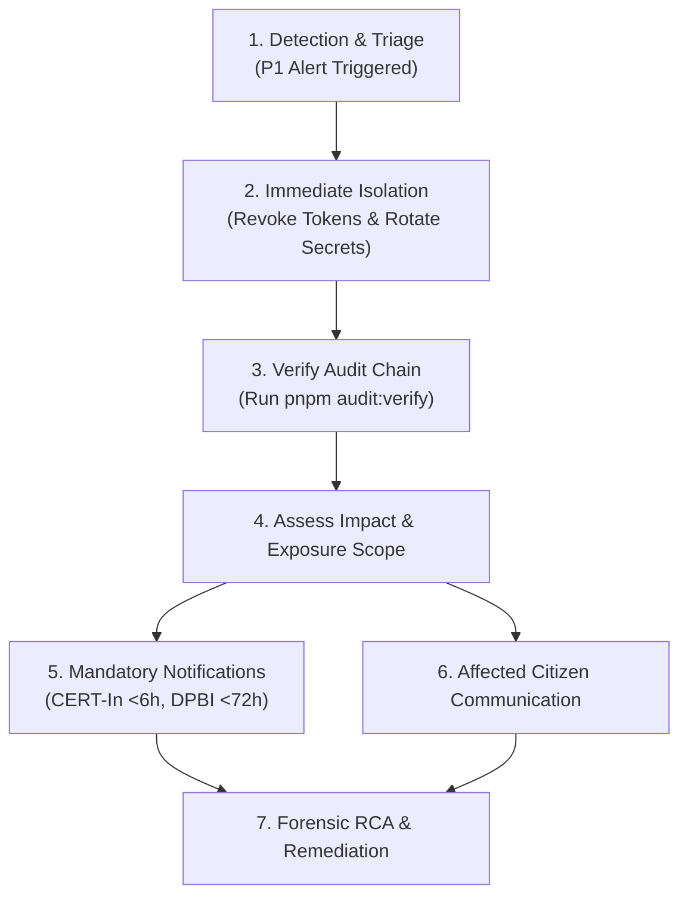

# Security & Personal Data Breach Incident Response Plan

> **Scope:** VoterRule Infrastructure, Databases, and API Services  
> **Compliance Frameworks:** DPDP Act 2023 / Draft DPDP Rules 2025; CERT-In Cyber Security Directions (Ref No. 20(3)/2022-CERT-In dated 28 April 2022); ISO/IEC 27035.  
> **Last Verified:** October 2026

---

## 1. Incident Classification Matrix

| Severity | Definition | Examples | Response SLA |
|:---|:---|:---|:---:|
| **P1 - Critical** | Breach or unauthorized exfiltration of personal data, compromise of encryption keys (KMS/DEK), or tampering with the immutable audit chain. | AES-GCM DEK exposed, unencrypted DB dump exfiltrated, mass session hijacking. | Immediate containment (< 1 hr); CERT-In within 6 hrs; DPBI notification within 72 hrs. |
| **P2 - High** | Unauthorized administrative privilege escalation, localized PII exposure (single record), or failed brute-force bypass on rate limiters. | Staff TOTP compromised, single account takeover, partial S3 bucket misconfiguration. | Containment within 4 hrs; Root-cause identification within 12 hrs. |
| **P3 - Medium** | Denial-of-service degradation, minor security scanner alerts, or transient policy rejection spikes. | Elevated 403 Forbidden spikes on public endpoints, abnormal SMS OTP consumption. | Resolution within 24 hrs. |

---

## 2. Statutory Notification Timelines & Authorities

### 2.1 CERT-In (Indian Computer Emergency Response Team)
* **Statutory Mandate:** Section 70B(6) of the Information Technology Act, 2000 and CERT-In Cyber Security Directions 2022.
* **Deadline:** Mandatory reporting within **6 hours** of noticing or being notified of the cybersecurity incident.
* **Channel:** Email to `incident@cert-in.org.in` or via official CERT-In Incident Reporting Portal (`cert-in.org.in`).
* **Reporting Incident Formats:** Target IP/domains, nature of attack, timeline, logs, affected systems, remediation steps taken.

### 2.2 Data Protection Board of India (DPBI)
* **Statutory Mandate:** Section 8(6) of the Digital Personal Data Protection Act, 2023.
* **Deadline:** Intimation within **72 hours** (or period prescribed under notified DPDP Rules) of determining a personal data breach has occurred.
* **Channel:** DPBI Designated Digital Portal / Email.
* **Information Required:**
  1. Nature and extent of personal data compromised (blind index vs decrypted plaintext).
  2. Estimated number of affected data principals (citizens).
  3. Potential consequences and risks to affected data principals.
  4. Immediate containment and remedial measures executed.
  5. Contact details of the Data Protection Officer (DPO).

---

## 3. Immediate Containment Runbook



### Step 1: Emergency Access Revocation & Key Rotation
When personal data exposure or key compromise is suspected:
1. **Rotate Root Encryption Master Key:**
   ```bash
   # Emergency rotation of KMS Data Encryption Key (DEK)
   node -r dotenv/config apps/api/dist/cli/rotate-encryption-key.js --immediate
   ```
2. **Revoke All Active Staff & Citizen Sessions:**
   ```sql
   UPDATE sessions SET is_revoked = true WHERE is_revoked = false;
   ```
3. **Invalidate Object Storage Pre-Signed URLs:**
   Rotate MinIO/S3 access credentials in environment variables and restart API pods.

### Step 2: Audit Chain Integrity Verification
VoterRule maintains a cryptographically linked SHA-256 hash chain for all administrative and citizen actions.
Execute the integrity verifier to confirm whether audit records have been tampered with:
```bash
pnpm --filter @voterrule/api exec node dist/cli/verify-audit-chain.js
```
* **Output `CHAIN_INTACT`:** Proceed with standard forensic log analysis.
* **Output `CHAIN_BROKEN at Block #N`:** Immediately quarantine database instance and switch read replica to read-only forensic mode.

---

## 4. Statutory Notification Templates

### 4.1 Notice to Data Protection Board of India (DPBI)

```text
To: Data Protection Board of India (DPBI)
Subject: Intimation of Personal Data Breach pursuant to Section 8(6), DPDP Act 2023
Date: [YYYY-MM-DD HH:MM IST]
Incident Reference: MS-INC-[YEAR]-[ID]

1. IDENTITY OF DATA FIDUCIARY:
   Entity Name: VoterRule Civic Initiative
   Registration / DPO Contact: dpo@voterrule.org | +91-XXXXXXXXXX

2. NATURE AND SCOPE OF BREACH:
   Description: [Describe unauthorized access / exfiltration / transmission]
   Category of Data Involved: [Citizen contact intimation / Identity proof document]
   Note on Aadhaar: Zero Aadhaar numbers are collected or stored by system design.
   Field Encryption Status: All stored PII is encrypted under AES-256-GCM. 
   [Specify if key was exposed or if only ciphertext was accessed].
   Approximate Electors Affected: [Number of Data Principals]

3. POTENTIAL CONSEQUENCES:
   Assessed Risk: [Low / Moderate / High]
   Potential Harm: [Risk of unauthorized contact / civic confusion]

4. REMEDIAL & CONTAINMENT MEASURES EXECUTED:
   - All active authentication tokens revoked at [Timestamp].
   - Encryption master keys rotated at [Timestamp].
   - Ingress endpoints locked down via Cloudflare / AWS WAF.
   - Comprehensive hash-chain verification executed across audit logs.

5. COMMUNICATION TO DATA PRINCIPALS:
   Itemized SMS and email notices dispatched on [Timestamp] with guidance.

Submitted by: [Name & Designation, Data Protection Officer]
```

### 4.2 Bilingual Notice Template to Affected Citizens

#### English Version:
```text
Important Notice Regarding Your VoterRule Account (Portal Ref: {case_ref})

Dear Citizen,

We are writing to inform you of a security incident that may have involved your contact details submitted on the VoterRule civic portal.

What Happened: On [Date], our automated monitoring detected unauthorized access to [System/Service]. 

What Data Was Involved: Your registered mobile number and portal reference ID. 
Please note: Your Aadhaar number was NEVER collected, stored, or compromised, as VoterRule does not process Aadhaar numbers.

What We Did: We immediately blocked the unauthorized access, invalidated all active login sessions, and rotated our cryptographic keys. We have informed the Data Protection Board of India.

What You Should Do: 
1. Log in securely to your VoterRule dashboard and verify your pending inquiries.
2. Beware of unsolicited messages or calls asking for OTPs or personal documents. Official election staff will never ask for bank details or passwords.
3. For statutory roll queries, you may directly call the national voter helpline at 1950.

If you have questions, please reach our Data Protection Officer at privacy@voterrule.org.
```

#### Hindi Version (हिन्दी):
```text
आपके VoterRule खाते से संबंधित महत्वपूर्ण सुरक्षा सूचना (केस संदर्भ: {case_ref})

प्रिय नागरिक,

हम आपको सूचित कर रहे हैं कि VoterRule पोर्टल पर आपके द्वारा दर्ज किए गए संपर्क विवरण से संबंधित एक सुरक्षा घटना संज्ञान में आई है।

क्या हुआ: [दिनांक] को हमारी सुरक्षा प्रणाली ने [सिस्टम] पर एक अनधिकृत पहुंच का पता लगाया।

कौन सा डेटा प्रभावित हुआ: आपका पंजीकृत मोबाइल नंबर और केस संदर्भ संख्या।
कृपया ध्यान दें: आपका आधार नंबर कभी भी संग्रहीत या एकत्र नहीं किया गया था, क्योंकि VoterRule आधार नंबर स्वीकार नहीं करता है।

हमने क्या कदम उठाए: हमने तुरंत अनधिकृत पहुंच को रोक दिया, सभी सक्रिय सत्रों को समाप्त कर दिया और एन्क्रिप्शन कुंजियों को बदल दिया। हमने भारतीय डेटा संरक्षण बोर्ड (DPBI) को विधिवत सूचित कर दिया है।

आपको क्या करना चाहिए:
1. पोर्टल पर सुरक्षित रूप से लॉगिन करके अपनी केस स्थिति की समीक्षा करें।
2. किसी भी अज्ञात संदेश या कॉल पर ओटीपी (OTP) या बैंक विवरण साझा न करें। आधिकारिक चुनाव कर्मी कभी पासवर्ड नहीं मांगते।
3. किसी भी आधिकारिक सहायता के लिए राष्ट्रीय मतदाता हेल्पलाइन 1950 पर संपर्क करें।

किसी भी प्रश्न के लिए हमारी गोपनीयता टीम से privacy@voterrule.org पर संपर्क करें।
```
