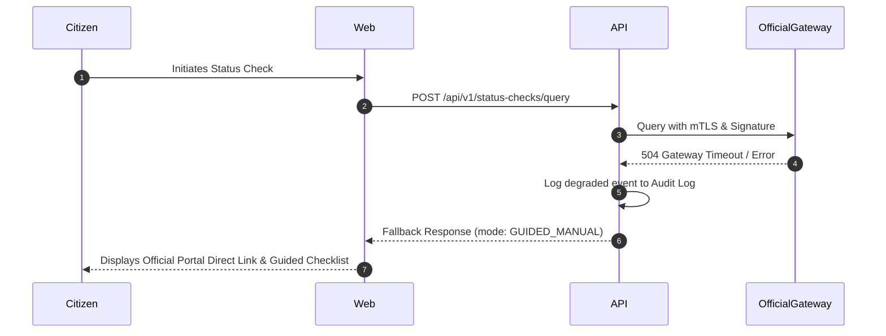

# Electoral Roll Integration & Provider Architecture

> **Document Status:** Architectural Specification & Regulatory Interface  
> **Key Rule:** Zero Web Scraping. Zero CAPTCHA Circumvention. Zero Shadow Databases.

---

## 1. Principles & Non-Negotiable Boundaries

VoterRule operates under three strict integration principles:
1. **Never scrape or automate official portals:** The platform does not use Puppeteer, Selenium, Playwright, or reverse-engineered private endpoints to access `voters.eci.gov.in` or State CEO websites. Doing so violates terms of service, risks legal liability under the Information Technology Act (Section 43/66), and burdens public infrastructure.
2. **Never store a shadow copy of the electoral roll:** VoterRule does not download, ingest, or mirror electoral rolls in bulk. Official rolls belong exclusively to the competent election authorities.
3. **Graceful degradation to citizen-guided verification:** In the absence of an authorized statutory API gateway, the platform functions flawlessly via the **Guided Manual Lookup** workflow.

---

## 2. Provider Interface Architecture

The status check engine is abstracted behind the TypeScript interface `RollLookupProvider`:

```typescript
// packages/shared/src/types/integration.ts
export interface RollLookupQuery {
  epicNumber?: string;
  name?: string;
  relativeName?: string;
  stateCode: string;
  districtCode?: string;
  acNumber?: number;
  dobOrAge?: number;
}

export interface RollLookupResult {
  status:
    | 'CONFIRMED_PRESENT_IN_OFFICIAL_RESULT'
    | 'NOT_FOUND_IN_CHECKED_SEARCH'
    | 'DETAILS_APPEAR_INCONSISTENT'
    | 'SEARCH_COULD_NOT_BE_COMPLETED'
    | 'NEEDS_FURTHER_VERIFICATION';
  provenance: {
    sourceType: 'OFFICIAL_INTEGRATION' | 'USER_RECORDED_OFFICIAL_LOOKUP';
    timestamp: string;
    verifiedBy: string;
    evidenceRef?: string;
    stalenessDeadline: string;
  };
  matchedRecordMasked?: {
    maskedEpic: string;
    maskedName: string;
    partNumber: number;
    serialNumber: number;
    pollingStationName: string;
  };
}
```

---

## 3. Supported Provider Implementations

### 3.1 `GuidedManualProvider` (Active Default Mode)
* **Status:** Fully functional, requires zero external credentials.
* **Workflow:**
  1. Citizen enters their state, constituency, and EPIC/Name details into VoterRule.
  2. The portal generates a structured guidance card directing the citizen to the exact official statutory search portal (`https://voters.eci.gov.in/#/search-in-e-roll`).
  3. The citizen runs the query in their own browser and solves the official CAPTCHA directly.
  4. The citizen returns to VoterRule and records the result from 5 strictly allowed neutral outcomes:
     - `CONFIRMED_PRESENT_IN_OFFICIAL_RESULT`
     - `NOT_FOUND_IN_CHECKED_SEARCH`
     - `DETAILS_APPEAR_INCONSISTENT`
     - `SEARCH_COULD_NOT_BE_COMPLETED`
     - `NEEDS_FURTHER_VERIFICATION`
  5. The platform attaches a provenance chip:  
     `[Self-reported official check on 30 Oct 2026 • Valid for 30 days]`.

### 3.2 `OfficialApiGatewayProvider` (Production Integration Mode)
* **Status:** Ready for sanctioned API keys upon formal statutory MoU or API access authorization from competent election authorities.
* **Environment Variables:**
  ```env
  OFFICIAL_ROLL_API_ENABLED=true
  OFFICIAL_ROLL_API_URL=https://api.voters.eci.gov.in/v1/verified-search
  OFFICIAL_ROLL_API_KEY=sec_prod_live_xxxxxxxxxxxxxx
  OFFICIAL_ROLL_API_SIGNING_CERT=/etc/ssl/certs/voterrule-client.pem
  ```
* **Security Constraints:**
  - Requests must be digitally signed with VoterRule's mTLS client certificate.
  - Returned payloads are verified against the ECI public key before recording stage transitions.
  - Rate-limited to max 10 requests per minute per IP to prevent search exhaustion.

---

## 4. Degraded Fallback Behavior

If `OFFICIAL_ROLL_API_ENABLED=true` is configured but the remote gateway returns `503 Service Unavailable`, `504 Gateway Timeout`, or network connection fails:



1. The API immediately logs an incident to the audit ledger: `ROLL_GATEWAY_DEGRADED`.
2. The response does not fail; it returns `fallbackToGuided: true` with direct official portal instructions.
3. The citizen is never blocked from obtaining assistance or preparing Form 6/8.
